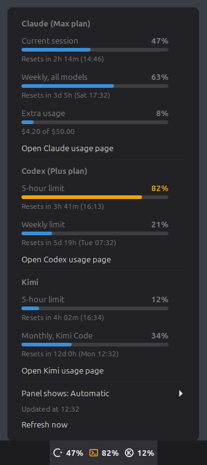

# AI Usage Limits for Cinnamon

A Cinnamon panel applet that shows how much of your AI subscription limits
you have used and when they reset. It supports Claude (Anthropic), Codex
(OpenAI) and Kimi (Moonshot AI), and new providers can be added as separate
modules.



User documentation: [ai-usage@dmcallejo/README.md](ai-usage@dmcallejo/README.md)

## Install from source

```sh
git clone https://github.com/dmcallejo/cinnamon-ai-usage.git
cd cinnamon-ai-usage
make install
```

Then right click the panel, choose **Applets** and add **AI Usage Limits**.

Tested on Linux Mint 22.3 with Cinnamon 6.6. Should work on Cinnamon 5.4 and
later (libsoup 2 and 3 are both supported).

## Development

See [CONTRIBUTING.md](CONTRIBUTING.md) for the code layout, how to add a
provider, and how to publish to Cinnamon Spices.

```sh
make check   # lint + unit tests
make reload  # reload the applet after editing
```

## License

GPL-3.0-or-later. See [LICENSE](LICENSE).

Claude is a trademark of Anthropic. Codex and ChatGPT are trademarks of
OpenAI. Kimi is a trademark of Moonshot AI. This project is not affiliated
with or endorsed by any of them.
